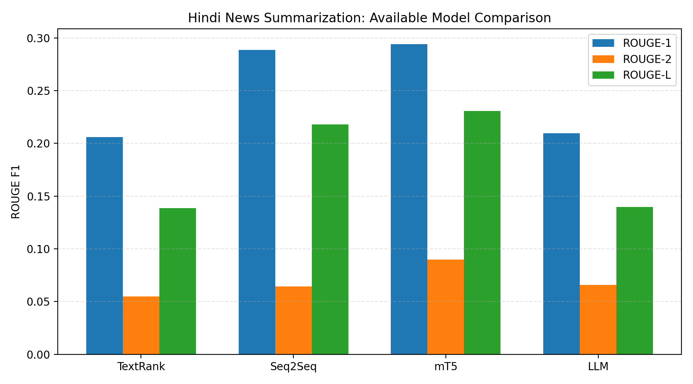

# Hindi News Summarisation: Methods, Evaluation, and Results

**Project:** P10 — Abstractive Summarisation of Hindi News  
**Dataset:** XL-Sum Hindi  
**Report prepared:** 21 November 2026  
**Scope:** TextRank, Seq2Seq with attention, fine-tuned mT5-small, and Gemini prompting

## Abstract

This project compares four approaches to summarising Hindi news articles: an extractive TextRank baseline, a custom Seq2Seq model with attention, fine-tuned mT5-small, and a prompted Gemini model. Automatic evaluation uses Unicode-aware ROUGE-1, ROUGE-2, and ROUGE-L F1. The main four-way comparison uses a deterministic shared sample of 100 articles. TextRank, Seq2Seq, and mT5 also have results for the complete 8,847-article test set. Human faithfulness and binary hallucination judgments were recorded for all four systems on the same 100 articles.

On the shared sample, mT5 achieved the highest ROUGE scores (ROUGE-1 0.2940, ROUGE-2 0.0896, and ROUGE-L 0.2307). Human annotations recorded hallucination rates of 0% for TextRank, 100% for Seq2Seq, 100% for mT5, and 1% for the LLM. These human results are descriptive judgments from one reviewer and should be interpreted with that limitation.

## 1. Introduction

News articles contain more detail than most readers need at a glance. Automatic summarisation aims to produce a shorter text that retains the central information. This project focuses on Hindi news and compares extractive, supervised neural, pretrained multilingual, and instruction-prompted methods.

The project objectives were to:

1. Prepare a shared Hindi news evaluation set.
2. Implement and evaluate multiple summarisation approaches.
3. Compare systems using a consistent Hindi-aware ROUGE scorer.
4. Assess factual faithfulness by human review and estimate hallucination rates.
5. Summarise the comparative findings and limitations.

## 2. Dataset and Evaluation Samples

The dataset is the Hindi split of XL-Sum, which pairs news articles with short reference summaries. The project’s prepared common test set contains **8,847 unique article IDs** and the fields `article_id`, `article`, and `reference`.

A deterministic final sample of **100 articles** was used for LLM generation and human assessment. The samples were prepared with seed 42. A separate 50-article development sample was prepared with no overlap with the final sample. The four-way ROUGE comparison and human review both use the same final 100 article IDs. The full-test comparison is reported separately and includes only systems with full-test predictions.

## 3. Systems

### 3.1 TextRank

TextRank is an extractive baseline. Articles are split into sentences using Hindi danda and common sentence punctuation. Character n-gram TF-IDF vectors (2–4 characters) are used to calculate sentence similarity; PageRank scores sentence importance. The top three sentences are returned in original article order, with a 100-word maximum.

### 3.2 Seq2Seq with attention

The custom encoder-decoder model uses attention and a vocabulary capped at 30,000 tokens. The documented training configuration uses 10 epochs, batch size 32, embedding and hidden dimensions of 256, dropout 0.2, learning rate 0.001, teacher forcing 0.5, and seed 42. The comparison baseline uses greedy decoding with repetition penalty 1.5 and a maximum output length of 100 tokens. Trigram blocking was tested separately; its full-test ROUGE change over penalty 1.5 was negligible.

### 3.3 Fine-tuned mT5-small

The mT5-small model was fine-tuned on the XL-Sum Hindi training data. The recorded run used 70,777 non-empty training pairs, 8,847 validation pairs, two epochs, batch size 8, learning rate 5e-4, weight decay 0.01, source and target maximum lengths of 400 and 100 tokens, fp32 precision, and seed 42. Inference used greedy decoding with repetition penalty 1.5.

A public checkpoint is available at [Anshugh/mt5-small-hindi-xlsum](https://huggingface.co/Anshugh/mt5-small-hindi-xlsum). The original Kaggle training checkpoint was not retained. The saved full-test mT5 predictions and reported ROUGE scores are from the earlier Kaggle run; a later Colab retrain was uploaded to the Hub, but its predictions have not been re-scored to establish exact equivalence. Results here therefore describe the saved mT5 prediction run and do not claim that the Hub checkpoint reproduced it.

### 3.4 Prompted Gemini

The LLM system uses Gemini `gemini-3.5-flash-lite` with the `faithful` Hindi summarisation prompt. Generation used temperature 0 and a maximum of 180 output tokens on the 100-article final sample. All 100 summaries were generated successfully. The API key is intentionally not recorded in project files or this report.

## 4. Evaluation Method

### 4.1 ROUGE

ROUGE-1, ROUGE-2, and ROUGE-L precision, recall, and F1 were calculated against the XL-Sum reference summaries. The scorer uses a Unicode-aware Hindi tokenizer that normalises text to NFC and keeps Unicode letters, combining marks, and numbers together; stemming is disabled. The same scorer is used for the common-sample comparison.

The four-way table below is a **100-article sample comparison**. Full-test scores are presented separately because no full-test LLM outputs were generated.

### 4.2 Human faithfulness and hallucination

One reviewer (initials BM in the review workbook) annotated each of the 100 article-summary pairs for all four systems, for **400 judgments** total. Faithfulness labels were `Faithful`, `Partially Faithful`, or `Unfaithful`. The binary hallucination flag is 1 when a summary contains an unsupported or contradicted factual claim and 0 otherwise. A partially faithful LLM summary was flagged as hallucinated.

The reported hallucination rate is:

> Number of summaries marked hallucinated ÷ number of summaries reviewed

These are sample-level human judgments, not automatic fact verification or population-wide estimates. There was no second-reviewer agreement measurement.

## 5. Results

### 5.1 Common 100-article ROUGE comparison

| Model | ROUGE-1 F1 | ROUGE-2 F1 | ROUGE-L F1 |
|---|---:|---:|---:|
| TextRank | 0.2058 | 0.0549 | 0.1386 |
| Seq2Seq (penalty 1.5) | 0.2886 | 0.0642 | 0.2179 |
| mT5-small | **0.2940** | **0.0896** | **0.2307** |
| Gemini 3.5 Flash-Lite | 0.2097 | 0.0659 | 0.1396 |

On this sample, mT5 had the highest F1 for all three ROUGE metrics. Seq2Seq was next on ROUGE-1 and ROUGE-L. The LLM exceeded TextRank on ROUGE-2 but was lower on ROUGE-1 and ROUGE-L. ROUGE measures overlap with references and does not by itself establish factual correctness or readability.

### 5.2 Full 8,847-article ROUGE results

| Model | ROUGE-1 F1 | ROUGE-2 F1 | ROUGE-L F1 |
|---|---:|---:|---:|
| TextRank | 0.2068 | 0.0522 | 0.1379 |
| Seq2Seq (penalty 1.5) | 0.2970 | 0.0808 | 0.2278 |
| mT5-small (saved Kaggle predictions) | 0.2951 | 0.0909 | 0.2313 |
| Gemini 3.5 Flash-Lite | Not evaluated on full test | Not evaluated on full test | Not evaluated on full test |

The full-test scores must not be directly conflated with the 100-article LLM sample scores. The latter are reported in the common-sample table.

### 5.3 Human faithfulness and hallucination results

| Model | Faithful | Partially Faithful | Unfaithful | Flagged hallucinated | Hallucination rate |
|---|---:|---:|---:|---:|---:|
| TextRank | 100 | 0 | 0 | 0 / 100 | 0% |
| Seq2Seq | 0 | 0 | 100 | 100 / 100 | 100% |
| mT5-small | 0 | 0 | 100 | 100 / 100 | 100% |
| Gemini 3.5 Flash-Lite | 99 | 1 | 0 | 1 / 100 | 1% |

These results follow the completed annotation workbook exactly. The perfect TextRank result and the 100% unfaithful labels for Seq2Seq and mT5 are notable extremes. They should be interpreted as this reviewer’s judgments on this sample and not generalized without additional independent review.

## 6. Discussion

The metrics show that model rankings depend on the evaluation dimension. mT5 leads the common-sample ROUGE scores, while the human annotations give it a high hallucination rate. This illustrates why lexical overlap and factual faithfulness should be reported together rather than treated as interchangeable measures.

TextRank has lower ROUGE scores than the neural models in the full-test comparison, but its extractive design copies sentences from the source rather than generating new claims. The annotation results show no hallucinations in the reviewed sample; this does not establish that TextRank can never produce a misleading or incomplete summary.

The LLM’s common-sample ROUGE scores are below mT5 and Seq2Seq, but its human annotations are substantially more favorable. This result is limited to one prompt, one model configuration, and 100 articles. It should not be interpreted as a general ranking of LLMs.

Seq2Seq decoding experiments found repetition penalty 1.5 improved over greedy decoding on the full test. Adding trigram blocking changed only a small number of summaries and yielded a negligible ROUGE gain, so the penalty-1.5 configuration was retained as the comparison baseline.

## 7. Limitations

1. Human review covered 100 articles and used a single reviewer; inter-annotator agreement was not measured.
2. The 100% Seq2Seq/mT5 and 0% TextRank hallucination rates are unusually extreme and need cautious interpretation.
3. LLM ROUGE and human judgments are available only for the 100-article sample, not the complete test set.
4. mT5 was trained for two epochs with one seed and no hyperparameter search. The saved prediction run is not proven to be exactly reproducible from the current Hub checkpoint.
5. ROUGE reflects reference overlap and can penalize valid paraphrases or reward lexical overlap without factual support.
6. Only one LLM prompt/model configuration was used for the final sample; prompt and provider model changes may affect results.
7. Manual ratings are subjective, and the binary hallucination definition counts a partially faithful summary as hallucinated when it includes unsupported or contradicted factual claims.

## 8. Conclusion

Four Hindi news summarisation approaches were implemented or evaluated: TextRank, Seq2Seq with attention, mT5-small, and Gemini prompting. On the shared 100-article sample, mT5 had the strongest ROUGE scores, while the LLM had the most favorable recorded human faithfulness judgments. TextRank and Seq2Seq provide useful baseline contrasts, and the human review reveals quality differences that overlap metrics alone do not capture.

The most defensible conclusion is that system quality is multi-dimensional: ROUGE, factual support, and readability should be considered together. The human results are exploratory because they come from one reviewer and a limited sample. Future work should add an independent second reviewer, reconcile disagreements, and—if exact mT5 reproducibility is needed—score predictions generated from the currently published checkpoint.

## References

1. Hasan, T. et al. “XL-Sum: Large-Scale Multilingual Abstractive Summarization for 44 Languages.” Findings of ACL, 2021. [https://arxiv.org/abs/2106.13822](https://arxiv.org/abs/2106.13822)
2. Xue, L. et al. “mT5: A Massively Multilingual Pre-trained Text-to-Text Transformer.” NAACL, 2021. [https://arxiv.org/abs/2010.11934](https://arxiv.org/abs/2010.11934)
3. XL-Sum Hindi dataset. [https://github.com/csebuetnlp/xl-sum](https://github.com/csebuetnlp/xl-sum)
4. Fine-tuned mT5 checkpoint. [https://huggingface.co/Anshugh/mt5-small-hindi-xlsum](https://huggingface.co/Anshugh/mt5-small-hindi-xlsum)

## Reproducibility and Project Artifacts

- Shared test set: `01_Dataset/processed/common_test_set.csv`
- LLM final sample IDs: `01_Dataset/processed/llm_final_sample_ids.csv`
- TextRank predictions: `05_Predictions/textrank_predictions.csv`
- Seq2Seq baseline predictions: `05_Predictions/seq2seq_predictions_penalty_1.5.csv`
- mT5 predictions: `05_Predictions/mt5_predictions.csv`
- LLM predictions: `05_Predictions/llm_predictions.csv`
- Human annotation workbook: `06_Evaluation_Results/human_faithfulness_review.xlsx`
- ROUGE comparisons: `06_Evaluation_Results/rouge_comparison.xlsx`
- Hallucination analysis: `06_Evaluation_Results/hallucination_analysis.csv`
- TextRank and LLM scripts: `03_Source_Code/textrank/summarizer.py` and `03_Source_Code/llm/generate_summaries.py`
